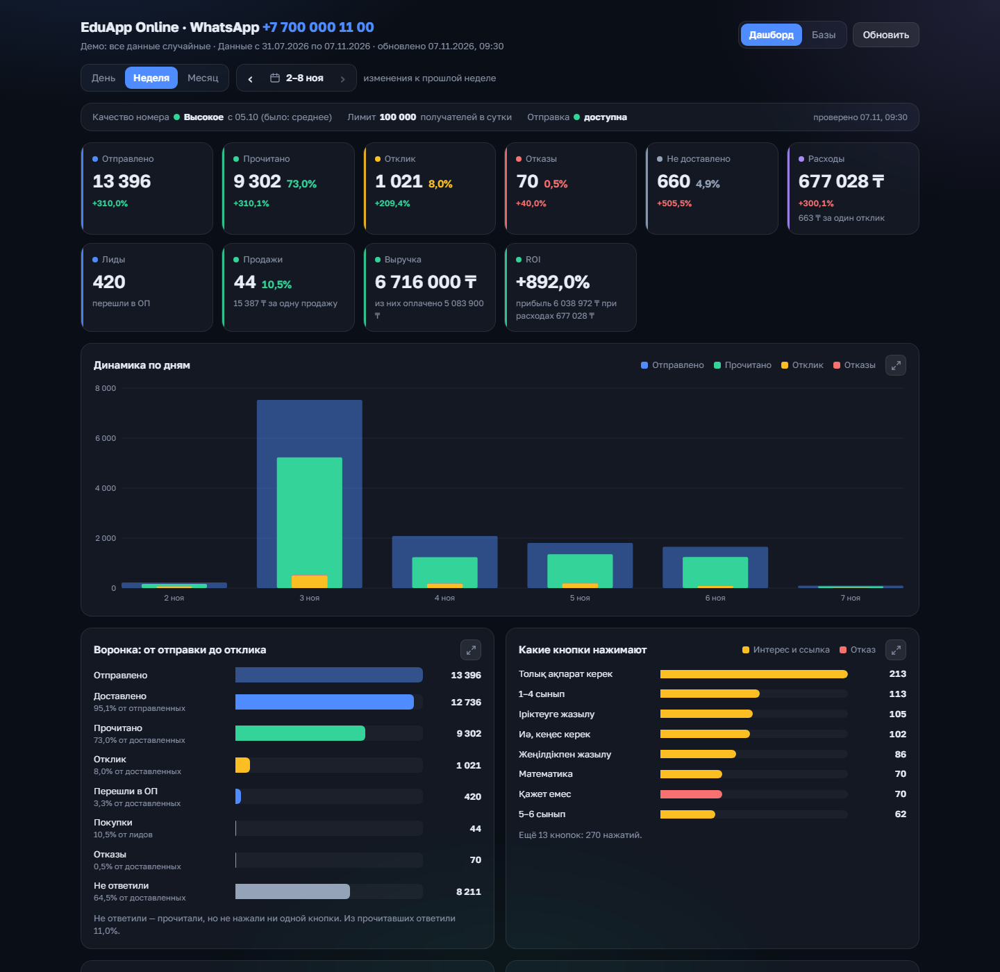

# Sales Analytics Dashboard (WhatsApp mailings → leads → revenue)

A dashboard that shows which WhatsApp template mailings actually sell: Meta template statistics collected by a
Google Apps Script, joined with CRM leads and sales (amoCRM history + Bitrix24), with ROI per template and per
mailing base, and an AI-written "which texts work" report.



> All data in this repository is randomly generated; brand names are anonymized.

## Features

- **Meta → Google Sheet pipeline** (`apps-script/Code.gs`): daily `template_analytics` import with 7-day
  re-sync, template classification by name and text (segment, theme, opener, price, urgency, length, emoji,
  link), phone quality / messaging limit monitoring, key-protected JSON endpoint (`doGet`) and notes (`doPost`).
- **CRM attribution**: Bitrix24 sync via incoming webhook + one-off amoCRM history ETL (`tools/amo`). Strict
  rules: a template counts only if Meta confirms ≥ 80% of the CRM sends; lead = move to sales ≤ 7 days after the
  mailing; revenue = paid + remaining debt.
- **Dashboard** (`web/app.js`, d3): KPIs with period-over-period change, daily dynamics, funnel
  (sent → delivered → read → response → lead → sale), button ranking, weekly response/refusal trend, best weekday,
  cost per response, sortable template table with WhatsApp-style message preview, Excel export.
- **Bases tab**: every mailing base with sends, leads, sales, revenue, ROI, Meta confirmation status and editable notes.
- **AI report**: printable PDF report; `api/insights.js` asks Claude / OpenAI / OpenRouter for structured JSON
  (what to repeat, what to avoid, A/B pairs, next experiments).
- **Two deployment targets**: Vercel Functions or a dependency-light Node server (`server.js`, Dockerfile).
- **Demo mode (default without keys)**: generated data, in-memory notes, canned AI answer.

## Tech stack

Vanilla JavaScript + d3 v7 · Node.js 18+ (Vercel Functions / `http` server) · Google Apps Script + Google Sheets ·
Meta Graph API (WhatsApp Business) · Bitrix24 REST · amoCRM API v4 · Anthropic SDK (Claude), OpenAI-compatible APIs.

## Project structure

```
apps-script/Code.gs            Google Sheet backend: Meta import, Bitrix24 sync, CRM attribution, doGet/doPost
web/index.html, app.js,        single-page dashboard
    styles.css, favicon.svg
web/api/data.js                sheet JSON + amoCRM history, cache, password check
web/api/insights.js            AI report (Claude / OpenAI / OpenRouter, JSON schema output)
web/api/notes.js, crm.js       base notes; CRM mock
web/api/_demo.js               demo mode: generated data, date shifting, in-memory notes, mock AI
web/api/sample-data.json       GENERATED demo data (sheet payload incl. Bitrix24 part)
web/api/amo-history.json       GENERATED demo amoCRM history
web/server.js, dev-server.js   own-server and local dev servers
scripts/generate-demo-data.js  random demo data generator
tools/amo/                     amoCRM history ETL (read-only)
docs/ARCHITECTURE.md           data flow and design notes
```

## How to run (demo mode)

Node.js 18+, no keys needed:

```bash
cd web
npm install          # only needed for the Claude SDK; demo works without it too
node dev-server.js   # http://localhost:5173
# or the production server: npm start  → http://127.0.0.1:3000
```

Regenerate the random data (optionally reproducible):

```bash
node scripts/generate-demo-data.js --seed 42 --days 100
```

## Production mode

Copy `web/.env.example` to `web/.env` (or set Vercel environment variables): `SHEET_API_URL`, `SHEET_API_KEY`,
`DASHBOARD_PASSWORD`, optionally `AI_API_KEY`. In the Google Sheet, paste `apps-script/Code.gs` into Apps Script,
set your WhatsApp Business account id, run "Connect and import" from the sheet menu and publish the web app.
See `docs/ARCHITECTURE.md`.

## Кратко (RU)

Дашборд показывает, какие шаблонные WhatsApp-рассылки приносят продажи.
Статистика Meta собирается в таблицу через Google Apps Script, объединяется с лидами и продажами из CRM (amoCRM, Битрикс24),
по каждому шаблону и базе считается ROI, а ИИ пишет вывод о текстах.
Запуск в демо-режиме без ключей: `cd web && node dev-server.js`.
Все данные в репозитории сгенерированы случайно, названия брендов изменены.
